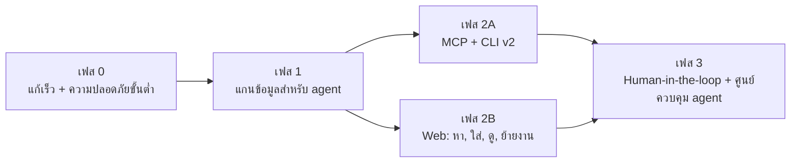
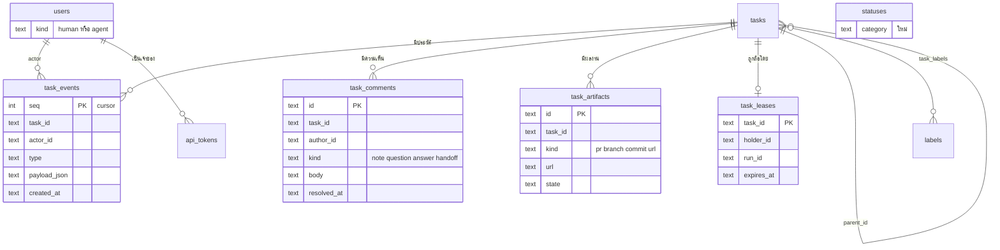
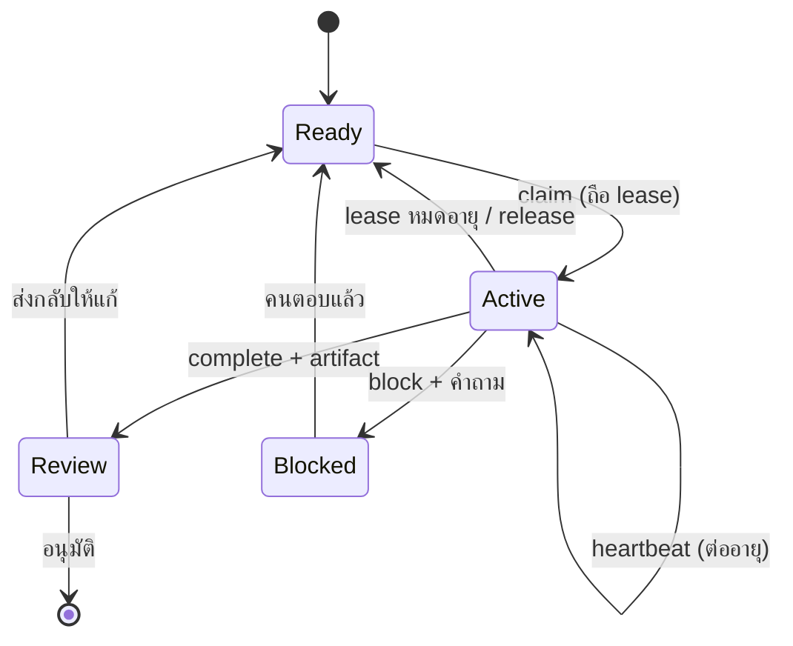
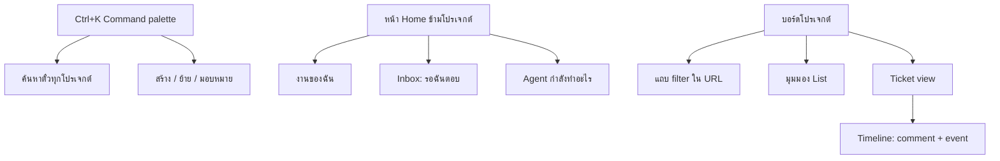
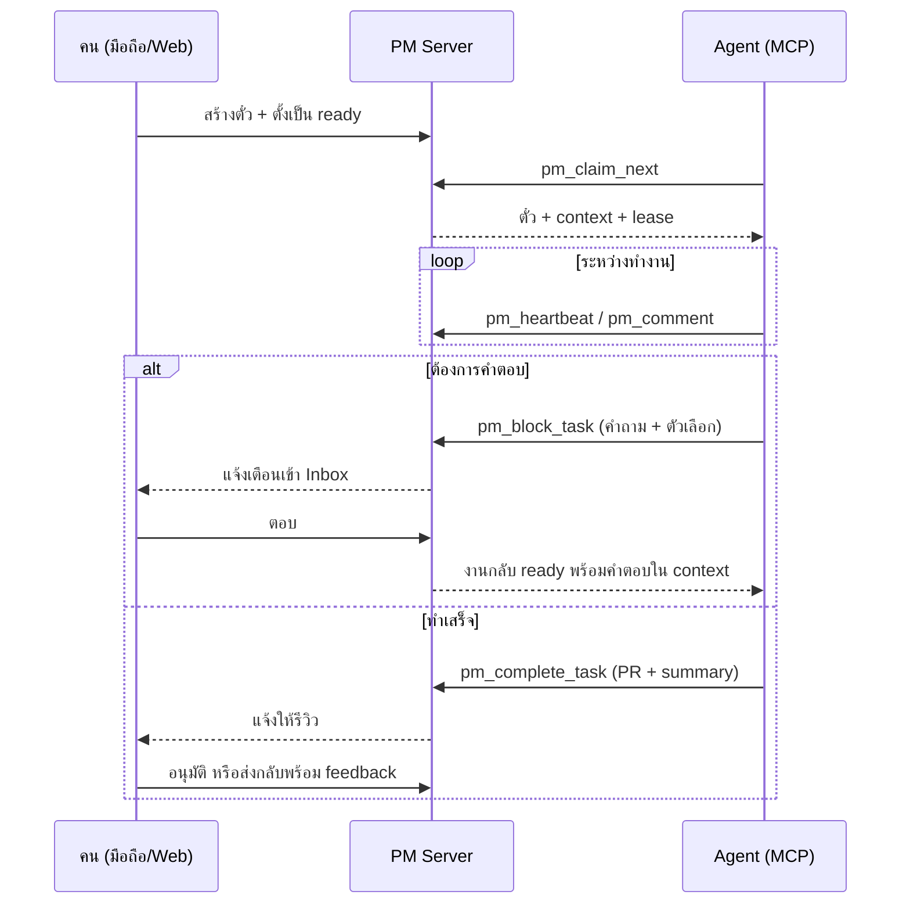

# แผนพัฒนา UX, CLI และ MCP สำหรับคนและ Agentic AI

วันที่ 2026-11-01 · **v2 2026-11-02** · สถานะ: M1 เสร็จ (#38-#42), ถัดไป M2

## v2: แผนที่ใช้ทำงานจริง

ส่วนนี้แทนลำดับเฟสเดิม หลังรีวิวใน [`2026-11-02-roadmap-scrutiny.md`](2026-11-02-roadmap-scrutiny.md) และการอ่าน prompt ของ capz-loop ส่วนที่ตามมาตั้งแต่ "สรุปสำหรับผู้ตัดสินใจ" เป็นรายละเอียดอ้างอิงของ v1 ถ้าขัดกับส่วนนี้ ให้ถือส่วนนี้เป็นหลัก

### สิ่งที่เปลี่ยนจาก v1

| v1 | v2 | เหตุผล |
|---|---|---|
| แก้ B1 ด้วย lease + claim endpoint | เพิ่ม `expect_from` (CLI `--from`) แบบเลือกใช้ | ปิดการ claim ซ้ำได้โดยไม่ทำให้การกู้งานค้างของ capz-loop พัง (F0) |
| 0.10 ตรวจผู้สร้างตั๋ว | agent สร้างตั๋วลงสถานะพร้อมทำไม่ได้, M2 ตรวจว่าคนเป็นผู้ย้ายเข้าสถานะนั้น | ประตูอนุมัติของเจ้าของต้องตรวจ transition ไม่ใช่ผู้สร้าง (F2b) |
| 0.1 `token show` + `login` คืน token เดิม | `pm token rotate` อย่างเดียว | ใช้ร่วมกับการเก็บ token แบบ hash ในอนาคตได้ (F1) |
| 1.5 agent ต้องส่ง `version` เมื่อแก้ description | ตัดออก | ทั้ง 4 stage ของ capz-loop เขียน STATUS โดยไม่ส่ง version (F2) |
| บังคับ auth (ไม่ระบุจุด) | wrapper กลางของ route + เทสต์ที่ไล่ทุก route | ไม่ให้ลืมบาง route (F3) |
| MCP 16 tools | MCP แบบบางสำหรับ Claude Code และ Codex บนเครื่องนี้ | client ที่ใช้จริงมี shell อยู่แล้ว (F4) |
| `pm mv --path` | ตัดออก | ข้ามจุดตรวจของ state machine (F5) |
| `statuses.category` | `projects.ready_status_key` (M2) | ทำตามแบบ `default_status_key` ที่มีอยู่ |
| event log + comment แยกตาราง | `task_activity` ตารางเดียว (M2) | Inbox, timeline และ `pm log` อ่านแหล่งเดียวกัน |
| lease, heartbeat, idempotency, labels, subtask, artifacts, agent runs, routing, webhook | ย้ายไป M4 | ทำเมื่อมีหลักฐานว่าต้องการ |
| dietpi | ตัดออก | เลิกใช้แล้ว เครื่องนี้เป็น instance เดียว |

### M1 ปิดรูรั่ว (เสร็จ 2026-11-02)

| PR | ขอบเขต |
|---|---|
| Claim และประตูอนุมัติ (#38, capz#156) | `expect_from` ใน `PATCH /api/tasks/:id` + `pm task move --from`, คอลัมน์ `users.kind` (`human`/`agent`), agent สร้างตั๋วลง `todo` ไม่ได้, แก้ skill `capz-build-ticket` ให้ใช้ `--from todo` และข้ามการ claim เมื่อเป็นงาน `recover:` |
| Auth (#40) | wrapper กลางที่ resolve actor, Bearer ผิดได้ `401`, `PM_AUTH_MODE=write-token`, `pm token rotate`, แก้เอกสารที่อ้างว่า `pm login` คืน token |
| CLI และ API (#41) | B4-B9, input ผิดได้ `400`, `did_you_mean`, `ready` ไม่คืนตั๋วที่ยังติด blocker, `view=summary` |
| Web (#39) | sidebar มือถือ, แถบบนของ drawer, ย้ายสถานะแล้ว drawer ไม่ปิด, quick add ต่อเนื่อง, หรี่คอลัมน์ที่ลากไปไม่ได้, หน้าแรกไม่เลือกโปรเจกต์ที่ซ่อน, ลากด้วยคีย์บอร์ด |
| MCP แบบบาง (#42) | `/api/mcp` (Streamable HTTP, stateless, Bearer เดิม) 9 tools ตั้งค่าให้ Claude Code และ Codex บนเครื่องนี้, อัปเดต skill และเอกสาร |

**ลำดับ deploy:** merge แล้ว `docker compose up -d --build` จากนั้นจึงแก้ skill ของ capz-loop ทุกการเปลี่ยนแปลงฝั่ง server เข้ากันได้กับผู้เรียกเดิม

### M2-M4

- **M2 ความจำของงาน:** `task_activity`, `pm comment`/`pm log`, timeline, Inbox, `ready_status_key`, `/ready` ตรวจว่าคนย้ายเข้าสถานะพร้อมทำ, ย้าย capz-loop จาก STATUS มาใช้ comment
- **M3 หาและดู:** FTS5 search, command palette, filter, Home ข้ามโปรเจกต์, SSE ที่อ่านจากตาราง activity, ขยาย MCP ตามการใช้งานจริง
- **M4 เมื่อจำเป็น:** lease/heartbeat, idempotency, labels, subtask, artifacts, agent runs, routing, webhook โดยเริ่มเมื่อมี poller ตั้งแต่สองตัวแย่งงานกัน หรือต้องกู้ตั๋วด้วยมือเกินสัปดาห์ละครั้ง

---

## สรุปสำหรับผู้ตัดสินใจ

ระบบตอนนี้ใช้งานได้ดีในฐานะบอร์ดที่มี agent ช่วยย้ายการ์ด แต่ยังไม่พร้อมให้ agent ทำงานเองเต็มรูปแบบ ช่องว่างที่สำคัญที่สุดมี 3 ข้อ

1. **การ claim งานไม่ใช่ lock จริง** agent 3 ตัวสั่ง `todo → doing` พร้อมกันแล้วสำเร็จทั้ง 3 ตัว จึงอาจทำงานซ้ำกันได้
2. **ไม่มีความจำของงาน** ไม่มี comment, history หรือ audit log ทำให้ agent ต้องเขียนความคืบหน้าทับลงใน description
3. **ไม่มีแนวกั้นความปลอดภัย** ใครก็ตามที่เข้าถึง API ได้สามารถสร้างตั๋วที่ poller หยิบไปรันโค้ดอัตโนมัติ หรือลบทั้งโปรเจกต์ได้โดยไม่ต้องมี token

ฝั่งคนใช้ ปัญหาหลักคือไม่มี search/filter, สถานะอยู่ลึกใต้ description ยาว ๆ และหน้ามือถือแทบใช้งานบอร์ดไม่ได้

**ข้อเสนอ:** แบ่งเป็น 4 เฟส เริ่มจากแก้ของเล็กที่กระทบสูง จากนั้นวางแกนข้อมูล (event log, comment, lease) แล้วจึงต่อ MCP/CLI และ Web บนแกนเดียวกัน MCP ควรมาหลังแกนนี้ เพราะถ้าทำก่อนจะได้แค่ทางเข้าใหม่สู่ปัญหาเดิม

---

## 1. สิ่งที่พบจากการลองใช้จริง

ทดสอบบน instance แยก (`next dev` พอร์ต 3007) ที่ใช้สำเนาของ DB จริง จึงไม่กระทบบอร์ดบนพอร์ต 3000 ข้อมูลตั้งต้นมี 21 โปรเจกต์ 549 ตั๋ว

### 1.1 บั๊กและความไม่ตรงกันที่ยืนยันแล้ว

| # | สิ่งที่พบ | หลักฐาน | ผลกระทบ |
|---|---|---|---|
| B1 | claim พร้อมกันสำเร็จทุกตัว | `task move --status doing` พร้อมกัน 3 ครั้งได้ v2, v3, v4 ไม่มี error เพราะ `canTransition` ถือว่าย้ายไปสถานะเดิมผ่านเสมอ (`lib/statemachine.ts:65`) และยัง bump version | งานถูกทำซ้ำ, README ที่บอกว่า "status is the lock" ไม่จริง |
| B2 | `pm login` ไม่คืน `api_token` | ได้แค่ `{user}` แต่ `AGENTS.md`, skill และ help บอกว่าได้ token | token แสดงครั้งเดียวตอนสมัคร ถ้าหายต้องสร้าง user ใหม่ ไม่มีทาง rotate |
| B3 | ใช้ token ผิดแล้วเงียบ | ตั้ง `PM_TOKEN=null` แล้ว `whoami` ตอบ `{"ok":true}` และตั๋วที่สร้างมี `creator_id: null` | agent เข้าใจว่าล็อกอินแล้ว |
| B4 | `pm ready` กลบ typo | โปรเจกต์หรือ assignee ที่ไม่มีอยู่คืน `[]` (`lib/repo.ts:607-619`) | agent สรุปว่า "ไม่มีงาน" |
| B5 | input ผิดกลายเป็น 500 | `task update --title` ที่ไม่มีค่าได้ `patch.title?.trim is not a function`; JSON เสียได้ 500 | error บอกทางแก้ไม่ได้ |
| B6 | `--version abc` ได้ `conflict` | ค่า `NaN` ถูกส่งเป็น `null` | agent จะ retry ผิดทาง |
| B7 | ค่าที่ขึ้นต้นด้วย `--` ใช้ไม่ได้ | `--title "--dashes in title"` ได้ `--title is required` | สร้างตั๋วจากข้อความอัตโนมัติพลาดได้ |
| B8 | ผลลัพธ์ pretty ขาดข้อมูล | `pm task get --pretty` แสดงแค่บรรทัด `✓ … → doing` ไม่มี description; `board`/`list` แสดง nanoid แทน ticket key | คนอ่านตั๋วจาก terminal ไม่ได้ |
| B9 | `--stdin` ไม่ atomic | สร้างทีละตั๋ว ถ้าพังกลางทางจะคืนแค่ error (`cli/pm.ts:398-406`) | retry แล้วได้ตั๋วซ้ำ |
| B10 | API เปิดสำหรับการเขียนและลบ | ไม่มี token ก็ `project delete` สำเร็จ, compose bind `0.0.0.0:3000`, register เปิดสาธารณะ | ดูหัวข้อ 1.3 |

### 1.2 ข้อจำกัดด้าน UX ฝั่งคน

| # | สิ่งที่พบ | หลักฐาน |
|---|---|---|
| U1 | ไม่มี search/filter ใด ๆ บนบอร์ด | ไม่มี input บนหน้าบอร์ด; capz คอลัมน์ Released ยาว 76 ใบ scroll สูง 10,868px |
| U2 | ไม่มีคีย์ลัด | กด `c`, `/`, `Ctrl+K`, `?` แล้วไม่มีอะไรเกิดขึ้น |
| U3 | บนมือถือ sidebar กินจอครึ่งหนึ่ง | ที่ 390px sidebar กว้าง 224px เหลือบอร์ด 166px, หน้าโหลดมาแบบกางอยู่ |
| U4 | Drawer เน้นผิดลำดับ | ชื่อหัวเป็น "Edit task", ไม่บอกสถานะปัจจุบันด้านบน, assignee/priority/ปุ่มย้ายสถานะอยู่ใต้ description ทั้งหมด |
| U5 | ย้ายสถานะแล้ว drawer ปิด | `move()` เรียก `onClose()` ทำให้เดินหลายขั้นต้องเปิดใหม่ทุกครั้ง |
| U6 | ลากการ์ดไม่รู้ว่าวางคอลัมน์ไหนได้ | มีแค่ highlight ตอน hover (`isOver`), ไม่หรี่คอลัมน์ที่ผิดกฎ |
| U7 | บอร์ดกว้างเกินจอ | 6-7 คอลัมน์ที่ 1440px ต้องเลื่อนแนวนอน คอลัมน์ท้ายอยู่นอกจอตอนลาก |
| U8 | Quick add ใส่งานต่อเนื่องไม่ได้ | กด Enter แล้ว composer ปิดและ focus หลุด, ตั้ง assignee/priority ไม่ได้ |
| U9 | การ์ดเก่าไม่มี key แสดงเป็น nanoid | เช่น `VFGTf8yp8YYN`, ไม่บอกอายุ, เหตุผลที่ติด, หรือ PR |
| U10 | หน้าแรกเปิดโปรเจกต์ที่ซ่อนอยู่ | เข้า `/` แล้วได้ `demoz` ซึ่ง `hidden=1` |
| U11 | ไม่มีมุมมองข้ามโปรเจกต์ | ไม่มี "งานของฉัน" หรือ "รอฉันตัดสินใจ" ทั้ง 21 โปรเจกต์ |
| U12 | ลากด้วยคีย์บอร์ดไม่ได้ | sensors มีแค่ Mouse กับ Touch |

### 1.3 ข้อมูลจริงบอกว่า agent กำลังใช้ระบบผิดรูปแบบ เพราะไม่มีเครื่องมือที่ใช่

| สัญญาณจาก DB | ความหมาย | สิ่งที่ควรมี |
|---|---|---|
| 70 ตั๋วมี `STATUS` ใน description; ยาวสุด 30,700 ตัวอักษร | ใช้ description เป็น log และเสี่ยงเขียนทับกัน เพราะ CLI ไม่บังคับ `--version` | comment/worklog แบบ append-only |
| 31 ตั๋วที่ `blocked` โดยเหตุผลอยู่ในข้อความ | ระบบไม่รู้ว่าติดอะไร และใครต้องตอบ | blocker แบบมีโครงสร้าง + Inbox |
| 235 ตั๋วมีชื่อขึ้นต้น `[bug]`, `[release]`, … | ใช้ title แทน label | labels |
| 35 ตั๋วเขียนทำนอง "Child of…" หรือ "Follow-up to…" | ใช้ข้อความแทนความสัมพันธ์ | subtask (`parent_id`) |
| 202 links ที่รวม `blocks` 91 แต่ `/ready` ไม่ดู link เลย | ตั๋วที่ยังติด blocker ถูกหยิบไปทำได้ | ready ที่เคารพ dependency |
| 9 ตั๋วค้างใน `doing`, 4 ใบไม่ขยับตั้งแต่ก่อนตุลาคม | agent ตายแล้วงานค้าง (README ยอมรับว่าเป็น future work) | lease + heartbeat |
| 219 ตั๋วไม่มี creator, 143 ไม่มี assignee | ไม่รู้ว่าใครสั่งงาน | บังคับ actor สำหรับการเขียน |
| มีทั้ง `Codex` และ `codex` | username ไม่ normalize ตัวพิมพ์ | unique แบบ case-insensitive + ประเภท `agent` |

**ต้นทุน token และ bandwidth:**

- `pm board --project automated-pm --json` คืน 117 KB เพราะแนบ description เต็มทุกใบ
- `GET /api/tasks?project=capz` คืน 380 KB และแต่ละแท็บที่ focus อยู่ดึงซ้ำทุก 4 วินาที
- CLI ใช้เวลาเริ่มราว 0.5 วินาทีต่อคำสั่ง (`tsx`)
- พิมพ์คำสั่งผิดได้ help กลับมา 3.6 KB ทุกครั้ง

**ความเสี่ยงที่ต้องปิดก่อนขยาย agent:** `/ready` คืน description ให้ agent นำไปรันโค้ด แต่ `POST /api/tasks` ไม่ต้องใช้ token ดังนั้นใครก็ตามที่เข้าถึงพอร์ตได้สามารถฝังคำสั่งลงตั๋ว แล้วให้ poller รันด้วยสิทธิ์บนเครื่องพัฒนาได้ นี่คือช่องทาง prompt injection ที่ต่อตรงถึงการรันโค้ด

### 1.4 สิ่งที่ดีอยู่แล้วและต้องรักษาไว้

- Server บังคับกฎทั้งหมด และ error เป็น JSON ที่ branch ได้
- `conflict` คืน `current` ให้ reconcile ได้ทันที
- Soft delete, archive และ state machine ต่อโปรเจกต์
- CLI แยก pretty กับ JSON ตาม TTY
- Deep link ด้วย ticket key
- `--project` รับทั้ง id และชื่อ
- Drawer กันการปิดเมื่อมีงานยังไม่บันทึก

---

## 2. หลักการออกแบบ

1. **แกนเดียว ทางเข้าสามทาง** Web, CLI และ MCP เรียก logic ชุดเดียวใน `lib/repo.ts` กฎต้องไม่ถูกเขียนซ้ำใน MCP
2. **ทุกการเปลี่ยนแปลงมี actor และ event** โดยบันทึกใน transaction เดียวกับการเขียน
3. **Agent คือผู้ใช้ชั้นหนึ่ง** มีตัวตน สิทธิ์ และประวัติเหมือนคน และคนต้องตรวจสอบย้อนหลังได้ทุกอย่าง
4. **ประหยัด context เป็นค่าเริ่มต้น** list ส่งสรุป, ขอรายละเอียดเมื่อต้องการ
5. **Error ต้องบอกขั้นถัดไป** เช่น `illegal_transition` ต้องบอกสถานะที่ไปต่อได้
6. **ของเดิมไม่พัง** คำสั่ง CLI และ endpoint เดิมยังใช้ได้ระหว่างย้ายระบบ และ routine ที่รันอยู่ต้องไม่สะดุด
7. **ยังเรียบง่ายแบบ self-hosted** SQLite + Next.js ใน container เดียว ไม่เพิ่ม Redis หรือ queue

---

## 3. เฟส 0: แก้เร็ว + ความปลอดภัยขั้นต่ำ

ขนาดรวม: เล็ก · ไม่มีการเปลี่ยน schema ใหญ่ · แต่ละข้อแยก PR ได้

### CLI/API

| งาน | รายละเอียด | ปิด |
|---|---|---|
| 0.1 จัดการ token | เพิ่ม `pm token show` และ `pm token rotate` โดยยืนยันรหัสผ่าน, `pm login` คืน token จริง และแก้เอกสารให้ตรง | B2 |
| 0.2 Token ไม่ถูกต้องต้อง fail | ส่ง Bearer ที่ใช้ไม่ได้ได้ `401` เสมอ (ไม่ถอยไปเป็น anonymous), `whoami` คืน JSON `null` จริง | B3 |
| 0.3 Validate input ที่ขอบ API | JSON เสียและชนิดข้อมูลผิดได้ `400`, flag ที่ต้องมีค่าแต่ไม่มีได้ `cli_error`, `--version` ต้องเป็นตัวเลข | B5, B6 |
| 0.4 Parser | รองรับ `--title=--value` และ `--`, ใช้ `node:util parseArgs` | B7 |
| 0.5 `ready` เข้มงวด | project/assignee ที่ไม่มีได้ `not_found` | B4 |
| 0.6 Error กระชับ | คำสั่งผิดคืน `did_you_mean` แทน help ทั้งก้อน | ลด token |
| 0.7 Pretty ใช้งานได้จริง | `task get` แสดงเต็ม, `board`/`list` แสดง ticket key และ assignee | B8 |

### ความปลอดภัย

| งาน | รายละเอียด | ปิด |
|---|---|---|
| 0.8 `PM_AUTH_MODE` | `open` (ค่าเดิม) หรือ `write-token` ซึ่งการเขียนทุกอย่างต้องมี session หรือ token แต่การอ่านยังเปิด, เปิด `write-token` ใน compose ของเครื่องจริงหลัง routine ทุกตัวมี token | B10 |
| 0.9 ปิด register แบบเปิด | `PM_ALLOW_REGISTER=false` และให้ user ที่มีอยู่เป็นคนเชิญ/สร้าง bot | B10 |
| 0.10 Ready เฉพาะงานที่เชื่อถือ | `/ready` ไม่คืนตั๋วที่ `creator_id` เป็น null เว้นแต่ตั้ง `allow_anonymous_ready`; ตอนนี้ไม่มีตั๋ว `todo` ที่เข้าเงื่อนไขนี้ จึงเปิดได้โดยไม่กระทบคิวงาน | ช่อง injection |

### Web

| งาน | รายละเอียด | ปิด |
|---|---|---|
| 0.11 มือถือ | ซ่อน sidebar เป็น drawer ต่ำกว่า `md`, ปุ่ม hamburger, header บรรทัดเดียว | U3 |
| 0.12 Drawer แถบบนสุด | แสดง key + ชื่อ + สถานะ + ปุ่มย้ายสถานะ + assignee + priority เหนือ description | U4 |
| 0.13 ย้ายแล้วไม่ปิด | อัปเดตค่าใน drawer พร้อม toast มีปุ่ม Undo | U5 |
| 0.14 Quick add ต่อเนื่อง | Enter เพิ่มแล้วโฟกัสช่องเดิม, Esc ปิด, ค่าเริ่มต้น assignee = ผู้ใช้ปัจจุบัน | U8 |
| 0.15 Drag hint | ตอนลาก หรี่คอลัมน์ที่ผิดกฎโดยใช้ `allowedTargets` ที่มีอยู่แล้ว | U6 |
| 0.16 หน้าแรก | จำโปรเจกต์ล่าสุด ถ้าไม่มีให้เลือกโปรเจกต์แรกที่ไม่ซ่อน | U10 |

**เกณฑ์ผ่านเฟส 0:**

- หมุน token แล้วใช้ token เก่าไม่ได้
- ที่ `write-token` การเขียนแบบ anonymous ได้ `401`
- ทดสอบที่ 390px เห็นคอลัมน์เต็มความกว้าง
- ตั๋ว 30,000 ตัวอักษรเปิดแล้วย้ายสถานะได้โดยไม่ต้อง scroll

---

## 4. เฟส 1: แกนข้อมูลสำหรับ Agent

ขนาดรวม: ใหญ่ · ทุกอย่างในเฟสถัดไปขึ้นกับเฟสนี้ · migration แบบ additive ตามรูปแบบเดิมใน `lib/db.ts`

### 1.1 Event log

- ตาราง `task_events` แบบ append-only ที่มี `seq` เพิ่มขึ้นเรื่อย ๆ และเขียนใน transaction เดียวกับการเปลี่ยนแปลง
- `lib/repo.ts` รับ `actor` ในทุกฟังก์ชันที่เขียน โดย route อ่านจาก `currentUser`
- `GET /api/events?since=<seq>&project=&task=&limit=` ให้ agent และ UI ตามงานด้วย cursor เดียว

### 1.2 Comment / worklog

- `POST/GET /api/tasks/:id/comments` แบบ append-only, `kind`: `note | question | answer | handoff`
- `description` กลับไปเป็น "สเปกของงาน"
- ไม่ย้ายข้อความเก่าอัตโนมัติ และปรับ routine ให้เลิกเขียน `STATUS` ลง description

### 1.3 Status category

- เพิ่ม `statuses.category`: `backlog | ready | active | review | blocked | done`
- Backfill จาก key ที่รู้จัก (`todo→ready`, `doing→active`, `completed→review`, `blocked→blocked`) ส่วน key อื่นให้ตั้งใน Settings ได้
- เลิก hardcode `todo` ใน `/ready` เพราะมีโปรเจกต์ที่ใช้ `open`, `qa` และ `resolved` อยู่จริง

### 1.4 Claim แบบ atomic + lease

| Endpoint | พฤติกรรม |
|---|---|
| `POST /api/tasks/:id/claim` | ใน transaction เดียวตรวจว่าอยู่ category `ready`, ไม่มี lease ที่ใช้งานอยู่ และไม่มี blocker แล้วย้ายสถานะ ตั้ง assignee สร้าง lease ถ้าไม่ผ่านได้ `409 already_claimed` พร้อมผู้ถือ |
| `POST /api/tasks/next` | เลือกงานที่พร้อมอันดับสูงสุดแล้ว claim ในคำสั่งเดียว รองรับ `project`, `assignee`, `labels` คืน `204` ถ้าไม่มีงาน |
| `POST /api/tasks/:id/heartbeat` | ต่อ lease คืนค่า `cancel_requested` ให้ agent หยุดงานได้ |
| `POST /api/tasks/:id/release` | คืนงานพร้อมเหตุผล |
| `POST /api/tasks/:id/complete` | ย้ายไป category `review` พร้อม summary และ artifact |
| `POST /api/tasks/:id/block` | ย้ายไป category `blocked` พร้อมคำถามที่ถึงคน |

- ตัวเก็บ lease หมดอายุทำงานแบบ lazy ตอนอ่าน + `setInterval` ใน server: คืนงานสู่ `ready`, เขียน event และจำกัดจำนวน retry (`max_attempts`) ก่อนส่งเข้า `blocked`
- ทางเก่า `task move` ยังใช้ได้ แต่ย้ายไปสถานะเดิมจะไม่ bump version และตอบ `changed: false`
- ปรับ `/ready` ให้ตัดตั๋วที่มี blocker ยังไม่จบหรือมี lease อยู่ออก และเพิ่ม `ticket_key` กับ `version` ใน `ReadyTicket` (ปิด B1 ร่วมกับ claim)

### 1.5 รองรับการทำงานซ้ำและงานเป็นชุด

- Header `Idempotency-Key` บน endpoint สร้างและ action ทุกตัว เก็บผล 24 ชั่วโมง
- `POST /api/tasks/batch` สร้างหลายตั๋วแบบ all-or-nothing พร้อม `parent` และ link ระหว่างกันในชุด (ปิด B9)
- `PATCH` ที่มี `description` จาก agent ต้องส่ง `version` เมื่อ `actor.kind = agent`

### 1.6 โครงสร้างงาน

- `tasks.parent_id` สำหรับ subtask พร้อมตัวนับความคืบหน้า
- `labels` + `task_labels` พร้อมสคริปต์ย้าย `[bug]`, `[release]` จาก title โดยรันแบบ dry-run ให้ตรวจก่อน
- `task_artifacts` เก็บ PR, branch, commit และ URL
- ป้องกัน dependency cycle ตอนสร้าง link `blocks`

### 1.7 ตัวตนและสิทธิ์ของ agent

- `users.kind`: `human | agent`
- ตาราง `api_tokens`: หลาย token ต่อ user, เก็บแบบ hash, มีชื่อ, วันหมดอายุ, `last_used_at` และ scope `read | write | admin`
- ย้าย `users.api_token` เดิมเข้าตารางใหม่โดยไม่ทำให้ token ที่ใช้อยู่เสีย
- Action อันตราย (ลบโปรเจกต์, แก้ state machine) ต้องการ scope `admin`
- Username ไม่ซ้ำแบบไม่สนตัวพิมพ์สำหรับ user ใหม่ ส่วนคู่ `Codex`/`codex` ปัจจุบันต้องให้เจ้าของระบบรวมเอง

### 1.8 ค้นหาและดึงข้อมูลแบบประหยัด

- SQLite FTS5 ครอบคลุม title, description และ comment รวมตั๋วที่ archive แล้ว
- `GET /api/search?q=&project=&status=&assignee=&label=`
- `GET /api/tasks`: เพิ่ม `view=summary|full`, `fields=`, `limit`, `cursor`, `updated_since`
- `view=summary` ส่ง excerpt 200 ตัวอักษร พร้อม `has_more_description` (ค่าเดิมยังเป็น `full` เพื่อไม่ให้ของเดิมพัง)
- `GET /api/tasks/:id/context`: รวม task, comment ล่าสุด, blockers, artifacts, ทางไปต่อ และ repo URL ในคำขอเดียว

**เกณฑ์ผ่านเฟส 1:**

- ทดสอบ `claim` พร้อมกัน 20 ตัว ต้องสำเร็จ 1 และได้ `already_claimed` 19
- Agent หยุดส่ง heartbeat แล้วงานกลับเข้า ready อัตโนมัติ
- ตั๋วที่ถูก `blocks` ไม่โผล่ใน `/ready`
- ทุกการเขียนมี event ที่ระบุ actor
- ขนาด `view=summary` ของ capz ต่ำกว่า 40 KB (จาก 380 KB)
- ชุดทดสอบเดิมผ่านทั้งหมด และ routine เดิมรันได้โดยไม่ต้องแก้

---

## 5. เฟส 2A: MCP + CLI v2

### 5.1 MCP Server

**การตัดสินใจ:** ใช้ Streamable HTTP ที่ `/api/mcp` อยู่ใน Next app เดียวกัน แบบ stateless และ auth ด้วย Bearer token เดิม

- **เหตุผล:** เรียก `lib/repo.ts` ได้ตรง ไม่ต้องติดตั้งเพิ่มบนเครื่อง agent ใช้ข้ามเครื่องบน Tailscale ได้ และ `better-sqlite3` ยังอยู่ใน process เดียว
- **ทางเลือกที่ไม่เลือกก่อน:** stdio bridge (`pm mcp`) ทำเมื่อเจอ client ที่รองรับแต่ stdio เท่านั้น เพราะตัว bridge เป็นเพียงการ forward
- ตรวจ spec และเวอร์ชันล่าสุดของ MCP TypeScript SDK ตอนเริ่มงาน เพราะแผนนี้ยังไม่ได้ทดลองกับ SDK

**Tools** ตั้งใจให้น้อยและตรงกับเจตนา ไม่ใช่ map ทุก endpoint

| Tool | ใช้ทำอะไร | Annotation |
|---|---|---|
| `pm_whoami` | ตัวตนและ scope | read-only |
| `pm_list_projects` | โปรเจกต์ที่เข้าถึงได้ + repo URL | read-only |
| `pm_get_workflow` | สถานะ, category และทางไปต่อ | read-only |
| `pm_search_tasks` | ค้นหาและกรอง คืนแบบสรุป มี cursor | read-only |
| `pm_get_task` | context เต็มของตั๋ว | read-only |
| `pm_get_updates` | event ตั้งแต่ cursor | read-only |
| `pm_create_tasks` | สร้าง 1 ใบหรือเป็นชุด, idempotent | write |
| `pm_update_task` | แก้ field, ใช้ version | write |
| `pm_move_task` | ย้ายสถานะ, error บอกทางไปต่อ | write |
| `pm_comment` | เพิ่ม note/question/handoff | write |
| `pm_link_tasks` | blocks / relates / parent | write |
| `pm_claim_next` | รับงานถัดไปหรือระบุ id | write |
| `pm_heartbeat` | ต่อ lease | write, idempotent |
| `pm_complete_task` | ส่งงานพร้อม summary และ artifact | write |
| `pm_block_task` | ถามคน พร้อมตัวเลือก | write |
| `pm_release_task` | คืนงาน | write |

- **ไม่เปิดใน MCP รอบแรก:** ลบโปรเจกต์, แก้ state machine, สร้าง user, จัดการ token ให้ทำผ่าน Web หรือ CLI ที่มี scope `admin`
- **Resources:** `pm://project/{id}/board`, `pm://task/{key}`, `pm://project/{id}/workflow`
- **Prompts:** `work_on_next_ticket`, `triage_backlog`, `write_ticket` เพื่อรวมขั้นตอนแทนการคัดลอก prompt ใน routine
- **ความปลอดภัยของเนื้อหา:** ส่งเนื้อหาตั๋วแยก field เป็นข้อมูล พร้อม `creator` และ `trusted`, ระบุใน tool description ว่าเนื้อหาตั๋วเป็นข้อมูลไม่ใช่คำสั่งจากระบบ, จำกัดขนาดผลลัพธ์และบอกวิธีอ่านต่อ
- **รูปแบบ error:** `{ code, message, hint, next_actions, current }` และตั้ง `isError` เพื่อให้ agent แก้เองได้
- **การตั้งค่า:** `pm mcp config --client claude|codex` พิมพ์ค่าติดตั้งพร้อมวางให้

### 5.2 CLI v2

| กลุ่ม | คำสั่งใหม่ |
|---|---|
| ใส่งาน | `pm add "แก้บั๊ก login" -p high -a me -l bug`, `--description-file <path\|->`, `pm task import tasks.jsonl` |
| ดูงาน | `pm mine`, `pm inbox`, `pm search <q>`, `pm show PM-0002`, `pm log PM-0002`, `pm watch --project x` |
| สถานะ | `pm mv PM-0002 doing --path` เดินตามเส้นทางสั้นสุดเมื่อระบุ `--path`, `pm next-statuses PM-0002` |
| Agent | `pm claim`, `pm heartbeat`, `pm complete --pr <url> --summary-file -`, `pm block --ask "..."`, `pm release` |
| ควบคุมผลลัพธ์ | `--fields`, `--view summary`, `--limit`, `--cursor`, `--ndjson`, `--quiet` |
| ตั้งค่า | `pm init` สร้าง `.pm.json` ในรีโปเพื่อเลือกโปรเจกต์อัตโนมัติ, `pm doctor`, shell completion |
| ค้นพบตัวเอง | `pm schema [command] --json` คืน flags และรูปแบบผลลัพธ์, `pm <cmd> --help` รายคำสั่ง |

- Positional id เป็นตัวเลือกเพิ่ม และ flag แบบเดิมยังทำงาน
- ใช้ exit code แยกประเภท: `2` usage, `3` not found, `4` conflict, `5` illegal transition, `6` auth
- ลดเวลาเริ่ม: bundle CLI ด้วย esbuild แล้วรันด้วย `node` เป้าหมายต่ำกว่า 100 ms

### 5.3 เอกสาร

- รวม `AGENTS.md` กับ `.agents/skills/project-manager-cli/SKILL.md` ให้มีแหล่งจริงเดียว เพราะตอนนี้เนื้อหาซ้ำและไม่ตรงกับ `cli/pm.ts` (เช่น `task get`, `project restore`, B2)
- เพิ่มเทสต์ที่เทียบรายการคำสั่งในเอกสารกับ `pm schema`
- เขียน cc-bridge ใหม่เป็น `claim → heartbeat → complete` และลบข้อ limit ที่ปิดแล้ว

**เกณฑ์ผ่านเฟส 2A:**

- Claude Code และ Codex เชื่อม MCP ได้ด้วย token เดียว และทำครบ `claim → comment → complete` โดยไม่ใช้ shell
- MCP และ CLI ได้ผลลัพธ์เดียวกันจากชุดทดสอบ contract เดียวกัน
- Token ที่ใช้ทำงานทั้งรอบบนตั๋วขนาดกลาง ต่ำกว่าวิธีปัจจุบันอย่างน้อย 50% (วัดเทียบจาก routine จริง)
- Agent หลายตัวบน MCP ไม่รับงานซ้ำ

---

## 6. เฟส 2B: Web สำหรับหา ใส่ ดู และย้ายงาน

### ค้นหาและดูข้อมูล

| งาน | รายละเอียด | ปิด |
|---|---|---|
| 2B.1 Command palette | `Ctrl/⌘+K` ค้นตั๋วข้ามโปรเจกต์ (FTS), สลับโปรเจกต์, สร้างตั๋ว, สั่ง action กับตั๋วที่เปิดอยู่ | U1, U2 |
| 2B.2 Filter bar | ข้อความ, assignee, priority, label, สถานะ agent โดยเก็บใน URL เพื่อแชร์ลิงก์ได้ และบันทึกเป็นมุมมองได้ | U1 |
| 2B.3 List view | ตารางที่ sort ได้ เหมาะกับ 100+ ตั๋ว และเลือกหลายใบได้ | U1, U7 |
| 2B.4 Home ข้ามโปรเจกต์ | งานของฉัน, Inbox, งานที่ agent ทำอยู่, งานค้าง, ตัวนับในแถบเมนู | U11 |
| 2B.5 ลดความยาวคอลัมน์ final | แสดง 20 ใบล่าสุด + "ดูเพิ่ม" และเสนอ archive | U1 |
| 2B.6 มุมมองกะทัดรัด | ความหนาแน่นปรับได้ และยุบคอลัมน์เป็นแถบแนวตั้งเพื่อให้พอดีจอ | U7 |

### ใส่งานและปรับสถานะ

| งาน | รายละเอียด | ปิด |
|---|---|---|
| 2B.7 Quick add อัจฉริยะ | พิมพ์ `แก้ login !high @claude #bug` แล้วแยกเป็น field, วางหลายบรรทัดเพื่อสร้างหลายใบ | U8 |
| 2B.8 คีย์ลัด | `c` สร้าง, `/` ค้นหา, `j/k` เลื่อน, `Enter` เปิด, `m` ย้าย, `a` มอบหมาย, `p` priority, `?` รายการคีย์ | U2 |
| 2B.9 Bulk action | เลือกหลายใบแล้วย้าย มอบหมาย ตั้ง priority archive โดยมี Undo | ลดงานซ้ำ |
| 2B.10 เมนูสถานะที่การ์ด | คลิกป้ายสถานะเพื่อย้ายโดยไม่ต้องเปิด drawer และเป็นทางเลือกสำหรับคีย์บอร์ด/มือถือ | U5, U12 |

### Ticket view

| งาน | รายละเอียด |
|---|---|
| 2B.11 จัดวางใหม่ | จอกว้างแบ่งสองคอลัมน์ ซ้ายเป็นสเปก + timeline ขวาเป็น metadata, artifacts, links, subtasks; แสดงแบบอ่านก่อน และคลิกเพื่อแก้เฉพาะ field |
| 2B.12 Timeline | รวม comment และ event พร้อมป้ายคนหรือ agent |
| 2B.13 Inline autosave | Field สั้นบันทึกทันที ส่วน description มีร่างในเครื่อง ถ้าเจอ conflict แสดง diff ให้เลือกแทนการทิ้งงาน |

### การ์ดและความสดของข้อมูล

| งาน | รายละเอียด | ปิด |
|---|---|---|
| 2B.14 การ์ดบอกสถานะงาน | อายุงาน, สถานะ lease/agent, ป้าย blocked + เหตุผล, สถานะ PR, ความคืบหน้า subtask | U9 |
| 2B.15 Backfill ticket key | ออก key ให้ตั๋วเก่า, ตั้ง prefix ให้โปรเจกต์ที่ยังไม่มี | U9 |
| 2B.16 Realtime | SSE `/api/stream` ต่อยอดจาก event log ทำงานได้ใน Node container เดียว, ถอยกลับเป็น poll แบบ `updated_since` เมื่อหลุด, อัปเดต drawer ที่เปิดอยู่ด้วยป้าย "มีการเปลี่ยนแปลง" แทนการหยุด poll ทั้งหมด | ลดการโหลด 380 KB ทุก 4 วินาที |

### มือถือและ a11y

| งาน | รายละเอียด | ปิด |
|---|---|---|
| 2B.17 บอร์ดมือถือ | แถบสลับคอลัมน์แบบ snap, เมนูย้ายสถานะแทนการลาก, ปุ่มสร้างงานลอย | U3 |
| 2B.18 Inbox บนมือถือ | ตอบคำถามของ agent และอนุมัติด้วยการแตะครั้งเดียว (รองรับการใช้งานผ่านมือถือบน Tailscale) | U11 |
| 2B.19 Keyboard DnD + audit | เพิ่ม `KeyboardSensor`, ตรวจ WCAG AA และ focus | U12 |

**เกณฑ์ผ่านเฟส 2B:**

- จาก 21 โปรเจกต์ หาตั๋วด้วย key หรือคำได้ภายใน 2 คีย์ลัด
- สร้าง 5 ตั๋วต่อเนื่องโดยไม่ใช้เมาส์
- ย้ายสถานะจากมือถือไม่เกิน 2 แตะ
- การเปลี่ยนแปลงจาก agent ขึ้นบนบอร์ดภายใน 1 วินาที
- Playwright smoke ครอบคลุมเดสก์ท็อปและ 390px

---

## 7. เฟส 3: Human-in-the-loop + ศูนย์ควบคุม Agent

ทำให้ agent วิ่งเองได้โดยคนคุมเฉพาะจุดสำคัญ

| งาน | รายละเอียด |
|---|---|
| 3.1 Inbox และ Decision | `pm_block_task` มีคำถามและตัวเลือก, คนตอบใน Inbox แล้วงานกลับเข้าคิวพร้อมคำตอบ |
| 3.2 Approval gate | กำหนดการเปลี่ยนสถานะที่ agent ทำเองไม่ได้ต่อโปรเจกต์ เช่น `review → done` ต้องเป็น `human` |
| 3.3 Agent runs | ตาราง `agent_runs` เก็บ agent, ticket, เวลา, ผลลัพธ์, จำนวนครั้งที่ลองใหม่, token/cost ถ้า client รายงาน |
| 3.4 Agents dashboard | ใครทำอะไรอยู่, heartbeat ล่าสุด, งานค้าง, อัตราสำเร็จ, ปุ่มยกเลิก (ส่งผ่าน `cancel_requested`) |
| 3.5 แจ้งเตือนและ webhook | Outbound webhook ลงนาม HMAC พร้อม retry ใช้ต่อกับ Telegram/n8n; Web Push ทำเมื่อจำเป็น |
| 3.6 Routing | กฎต่อโปรเจกต์: label/priority → agent, จำกัดงานพร้อมกัน (WIP) ต่อ agent และต่อโปรเจกต์ |
| 3.7 Resume จาก PR comment | Webhook จาก GitHub อัปเดต `task_artifacts` และส่งงานกลับคิว ซึ่งเป็นข้อจำกัดเดิมใน cc-bridge |
| 3.8 Guardrails | Rate limit ต่อ token, งบจำนวน claim ต่อวัน, ปุ่ม pause ทั้งระบบหรือรายโปรเจกต์ |

**เกณฑ์ผ่านเฟส 3:** รันตั๋วทดลอง 20 ใบแบบไม่มีคนเฝ้า โดยคนแตะเฉพาะ Inbox และรีวิว ผลต้องไม่มีงานซ้ำ ไม่มีงานค้างเงียบ และทุก action สืบย้อนได้

---

## 8. ลำดับการส่งมอบ

ประมาณการเป็นค่าคร่าว ๆ สำหรับการพัฒนาโดย agent ที่มีคนรีวิว

| ลำดับ | ชุดงาน | ขนาด | เหตุผลที่อยู่ลำดับนี้ |
|---|---|---|---|
| 1 | 0.1-0.10 CLI + ความปลอดภัย | S-M | ปิดความเสี่ยง และทำให้ token ใช้งานได้จริงก่อน |
| 2 | 0.11-0.16 Web | S-M | เห็นผลทันที ทำคู่ขนานกับข้อ 1 ได้ |
| 3 | 1.1, 1.2, 1.3 Event + comment + category | M | ฐานของทุกอย่างที่เหลือ |
| 4 | 1.4, 1.7 Lease + token ใหม่ | L | ปลดล็อกการรัน agent หลายตัว |
| 5 | 1.5, 1.6, 1.8 Batch, โครงสร้าง, ค้นหา | M | ลด token และเตรียมให้ MCP |
| 6 | 2A MCP แล้วตามด้วย CLI v2 | M-L | ส่วนต่อประสานสำหรับ agent |
| 7 | 2B.1-2B.10 หาและใส่งาน | M-L | คุณค่าสูงต่อคนใช้ |
| 8 | 2B.11-2B.19 Ticket view, realtime, มือถือ | L | ต้องใช้ timeline/event |
| 9 | เฟส 3 | L | ต้องมีครบทั้ง Inbox, lease และ MCP |

### วิธีส่งงาน

- หนึ่ง PR ต่อหนึ่งงาน จาก worktree ที่แตกจาก `origin/main` และมีเทสต์ใน `lib/*.test.ts` ตามรูปแบบเดิม
- Migration ใน `lib/db.ts` ต้อง additive และ idempotent, สำรอง DB ก่อน deploy ด้วย `npm run db:export`
- ทดสอบ migration กับสำเนา DB จริงทุกครั้ง เพราะโปรเจกต์เก่ามี prefix และ `default_status_key` เป็นค่าว่าง
- ใช้บอร์ด `automated-pm` ติดตามงาน เพื่อให้แผนนี้เป็นการทดสอบระบบไปด้วย

### ความเสี่ยง

| ความเสี่ยง | การรับมือ |
|---|---|
| `write-token` ทำให้ routine ที่ไม่มี token หยุดทำงาน | ไล่ตรวจ routine ก่อน, บันทึก log anonymous write ในโหมด `open` ระยะหนึ่ง แล้วจึงเปิด |
| Event log โตเรื่อย ๆ | เก็บ payload เฉพาะ diff ของ field ที่เปลี่ยน และไม่เก็บ description เต็มในทุกการแก้ |
| SSE ติดกับ reverse proxy | มี fallback เป็น poll แบบ `updated_since` เสมอ |
| FTS5 ไม่ได้เปิดใน build ของ `better-sqlite3` | ตรวจในขั้นแรกของ 1.8, ถ้าไม่มีใช้ `LIKE` ชั่วคราว |
| Prompt injection จากเนื้อหาตั๋ว | Trusted-creator gate, แยกข้อมูลใน MCP, approval gate และ agent ไม่มีสิทธิ์ `admin` |

### ผลกระทบต่อ token และ session ที่ใช้อยู่

ข้อมูลจาก DB จริง ณ 2026-11-02: มี web session ที่ยังใช้ได้ 2 อัน, ตั๋วล่าสุดที่สร้างแบบไม่มี token คือ 2026-10-07 และตุลาคมมีตั๋วแบบนี้ 2 ใบ

| งาน | กระทบ token/session เดิมไหม | เงื่อนไขที่ต้องทำ |
|---|---|---|
| 0.2 Token ผิดได้ `401` | กระทบ routine ที่ตั้ง token ผิดอยู่ ซึ่งตอนนี้ทำงานแบบ anonymous โดยไม่รู้ตัว | ก่อนเปิด log เป็น warning ระยะหนึ่ง |
| 0.1 Rotate | กระทบเฉพาะตอนที่ผู้ใช้กด rotate เอง | ย้ำในผลลัพธ์ว่า token เก่าใช้ไม่ได้แล้ว |
| 0.8 `write-token` | ไม่กระทบจนกว่าจะเปิด | ค่าเริ่มต้นยังเป็น `open`, ตรวจ anonymous write ให้เป็น 0 ก่อนเปิด |
| 0.9 ปิด register | ไม่กระทบ user/token เดิม | — |
| 0.10 Ready เฉพาะงานที่เชื่อถือ | ไม่กระทบ token แต่คัดตั๋วที่ไม่มี creator ออก (ตอนนี้ไม่มีใน `todo`) | — |
| 1.7 เก็บ token แบบ hash | ไม่กระทบถ้า migration ถูกต้อง แต่ถ้าพังจะกระทบ routine ทุกตัวพร้อมกัน | ทดสอบกับสำเนา DB, เทสต์ที่ยืนยันว่า token เดิมทุกตัวยังใช้ได้, ไม่ลบคอลัมน์ `users.api_token` จนกว่าจะใช้ระบบใหม่ได้หนึ่งรอบ deploy |
| Web session (cookie) | ไม่กระทบในทุกเฟส | — |

### ตัวชี้วัดความสำเร็จ

| ตัวชี้วัด | ปัจจุบัน | เป้าหมาย |
|---|---|---|
| Claim ซ้ำจากการแข่งกัน | 3 ใน 3 สำเร็จ | สำเร็จ 1 |
| ตั๋วค้าง `doing` โดยไม่มีความเคลื่อนไหวเกิน 7 วัน | มีค้างตั้งแต่มิถุนายน | 0 (หมด lease แล้วคืน) |
| ตั๋วใหม่ที่ไม่มี creator | 40% ของตั๋วทั้งหมด | 0 |
| ขนาดข้อมูล list ของ capz | 380 KB | ต่ำกว่า 40 KB (`summary`) |
| ค่าข้อมูล poll ของแท็บที่เปิดอยู่ | สูงสุด 95 KB/วินาที | เฉพาะ event ที่เปลี่ยน |
| เวลาเริ่ม CLI | ~480 ms | ต่ำกว่า 100 ms |
| การหาตั๋วบนเว็บ | ไม่มี search | ไม่เกิน 2 คีย์ลัด |
| ใช้บอร์ดบนมือถือ 390px | เห็นบอร์ด 166px | เต็มจอ |

---

## 9. การตัดสินใจที่ใช้ในแผนนี้

แผนนี้เลือกค่าต่อไปนี้แล้ว ถ้าต้องการต่างออกไป ข้อ 1 เป็นข้อเดียวที่กระทบทิศทางจริง

1. **เปลี่ยนนโยบาย auth:** เดิมตั้งใจให้ API เปิดและ identity มีไว้ระบุผู้ทำเท่านั้น แผนนี้เปลี่ยนเป็นต้องมี token สำหรับการเขียน แต่อ่านยังเปิดได้ เพราะ agent ที่รันโค้ดเองจากตั๋วไม่ควรรับงานจากผู้ไม่ระบุตัวตน ทำผ่าน flag จึงย้อนกลับได้
2. **MCP แบบ HTTP ก่อน** และมี stdio เมื่อจำเป็น
3. **คง SQLite + container เดียว** ไม่ปรับไปใช้ Vercel หรือฐานข้อมูลภายนอก เพราะระบบเป็น self-hosted และ `better-sqlite3` ต้องการไฟล์ถาวร
4. **ไม่ทำ multi-tenant, RBAC ละเอียด, sprint หรือ time tracking** ในรอบนี้ เพราะข้อมูลการใช้งานจริงยังไม่แสดงความต้องการ
5. **Comment ไม่แทนข้อความ `STATUS` เก่าย้อนหลัง** เพราะแปลงอัตโนมัติแล้วเสี่ยงทำข้อมูลเพี้ยน

## 10. ขอบเขตการทดสอบครั้งนี้

- ทดสอบบน `next dev` ดังนั้นตัวเลขความเร็วของ server ไม่แทน production; ขนาดข้อมูลและเวลาเริ่ม CLI ใช้เป็นตัวเลขเปรียบเทียบได้
- **ยังไม่ได้ยืนยัน:** toast ตอนลากไปคอลัมน์ผิดกฎ (ตอนทดสอบตำแหน่งวางตกนอกจอ, โค้ดมีการ revert + toast) และพฤติกรรมของ drawer เมื่อบันทึกแล้วเจอ `conflict`
- ไม่ได้ทดสอบ upload รูป และการรัน routine จริงแบบครบวง (เครื่องนี้เป็น instance เดียว เพราะเลิกใช้ dietpi แล้ว)
- U12, B9 และ B4 มาจากการอ่านโค้ด ส่วนรายการอื่นในหัวข้อ 1.1-1.2 ได้จากการลองจริงร่วมกับโค้ด
