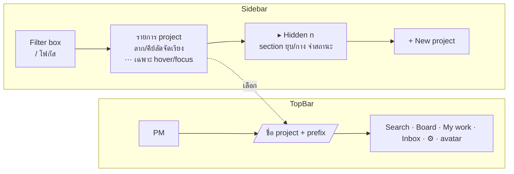
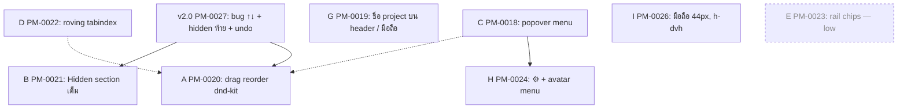

# Sidebar + top bar v2 — design notes (2026-11-06)

สถานะ: **ข้อเสนอ / ยังไม่ลงมือแก้** — เอกสารนี้ประกอบ tickets ชุด `[shell]` ใน project `automated-pm`
(ดูรายการ ticket ท้ายเอกสาร) ใช้เป็น spec กลางที่ ticket แต่ละใบอ้างถึง เพื่อไม่ต้องอธิบายซ้ำ

**ปรับ 2026-11-07 ตาม scrutiny** (`2026-11-07-sidebar-topbar-v2-scrutiny.md`): เพิ่มขั้น v2.0 (bug fix + ของเล็ก
ก่อนทุกใบ), G ไม่มี popover switcher และไม่ล้าง `selectedId`, A ใช้คีย์บอร์ด dnd-kit แบบเดียวกับบอร์ด,
E เลื่อน low, F ยกเลิก

วิธีตรวจ: อ่าน `components/Sidebar.tsx`, `components/Nav.tsx`, `components/AppShell.tsx`,
`components/useApp.ts` แล้วเปิด UI จริง (`http://localhost:3000`, user `uiverify`) ด้วย Playwright
ที่ 1440×900 และ 390×844 ทั้ง light/dark, วัดค่าจริงใน DOM, รัน `impeccable detect`
(ไม่พบ finding) และให้ sub-agent ทำ Nielsen heuristics review แยกอีกชุดโดยไม่เห็นผลของกันและกัน

## 1. สิ่งที่มีอยู่แล้ว (ไม่ต้องทำซ้ำ)

| ความสามารถ | สถานะ | ที่มา |
|---|---|---|
| Sidebar ซ้าย แสดง project ทุกตัว, ยุบเป็น rail, จำสถานะใน localStorage | มีแล้ว | ticket "[enhance] app sidebar" (tested) |
| Reorder ↑/↓, Hide, Archive, Delete ต่อ project ผ่านเมนู ⋯ (accordion ในแถว) | มีแล้ว | PM-0001 (completed) |
| `projects.sort_order`, `projects.hidden`, `archived_at`; API `POST /api/projects/reorder`, `PATCH … {hidden}`; CLI `pm project reorder`, `pm project update --hidden` | มีแล้ว | PM-0001 |
| Mobile: sidebar เป็น overlay drawer เปิดจาก ☰ | มีแล้ว | roadmap 0.11 / #39 |
| Command palette Ctrl/⌘+K สลับ project ได้ | มีแล้ว | M3 (#47) |

ดังนั้นชุดนี้คือ **ทำของเดิมให้ใช้ได้จริงกับ 20+ project** ไม่ใช่สร้างฟีเจอร์ใหม่จากศูนย์

## 2. ปัญหาที่พบ (หลักฐานจาก UI จริง)

ข้อมูลผู้ใช้จริง: 22 project (11 แสดง / 11 ซ่อน), sidebar กว้าง 224px, แถวสูง 32px ตัวอักษร 14px,
header สูง 61px, แถบหัว sidebar สูง 52px

### Sidebar

1. **Reorder ทีละช่อง** — ย้าย project จากท้ายขึ้นบนสุดใน 22 ตัว = กด ↑ 21 ครั้ง แต่ละครั้งยิง
   `POST /api/projects/reorder` + reload ทั้งรายการ
2. **↑/↓ ข้ามตัวที่ซ่อนอยู่แบบมองไม่เห็น** — `move()` สลับตำแหน่งใน *รายการเต็ม* (รวม hidden)
   ถ้าเพื่อนบ้านเป็น project ที่ซ่อน ผู้ใช้กด ↑ แล้ว "ไม่เห็นอะไรเปลี่ยน" (`Sidebar.tsx:135-142`)
3. **Hidden ปนกับ visible** — กด "Show hidden (11)" แล้ว project ที่ซ่อนแทรกตามลำดับเดิม
   มีแค่ glyph ⦸ บอก, สถานะ show/hide ไม่จำ (reset ทุก reload), ป้าย "Hide hidden" อ่านแล้วงง
4. **เลือก project ที่ซ่อนผ่าน URL แล้วไม่มีแถวไหน active** และไม่มีชื่อ project ที่ไหนบนจอ
   (`aria-current` = 0 แถว ตรวจจริงกับ `?project=JFF2zGVpB4Ld`)
5. **เมนู ⋯ เป็น accordion** — ดันรายการด้านล่างลง, ปุ่ม ↑ ↓ เป็น icon ล้วน, "Delete" (อันตราย)
   อยู่ชิด "Archive", ยืนยันลบด้วย `window.confirm` (ไม่เข้ากับ drawer/toast ที่ใช้ทั่วแอป)
6. **⋯ โชว์ทุกแถวตลอดเวลา** — 22 แถว = 22 ตัว ⋯ เป็น noise ในหน้าที่ควรสแกนชื่อ project
7. **คีย์บอร์ด** — Tab จากบนสุดต้องกด 25 ครั้งถึงจะออกจาก sidebar ไปถึง Search
   (ทุกแถวมี 2 tab stop: ชื่อ + ⋯) ไม่มี skip link, ไม่มี roving tabindex
8. **Rail ยุบแล้วเหลือแค่ »** — ไม่รู้ว่าอยู่ project ไหน สลับ project ไม่ได้โดยไม่กาง
9. **ไม่มี filter ในรายการ** — 20+ project ต้องเลื่อนหา (palette ค้นได้ แต่ไม่มี hint ใน sidebar)
10. คำว่า "Hide" ใช้ 3 ความหมาย: ปุ่ม « title "Hide projects" (ยุบ sidebar), action "Hide"
    (ซ่อน project), toggle "Hide hidden"

### Top bar

11. **ไม่มีชื่อ project ปัจจุบันบน top bar** — หน้า Board/Settings/Appearance/Archive/Trash
    ผูกกับ project แต่บอกได้จาก highlight ใน sidebar เท่านั้น (หายไปตอน rail/มือถือ)
12. **"Project ▾" เป็น `
` ดิบ** — คลิกข้างนอก/Esc ไม่ปิด (ตรวจจริง: `open` ยังเป็น true),
    ไม่มี role=menu/arrow keys; ป้าย "Project" ชนกับ "PROJECTS" ของ sidebar (คนละความหมาย)
13. **ของไม่เข้าชุด**: brand "📋 PM", theme toggle ☀️/🌙, "👤 username" เป็น emoji ขณะที่ ☰ 🔍 ⎋
    เป็น SVG; ปุ่ม nav active เป็นสี่เหลี่ยมมุมฉาก (`ring-1` ไม่มี `rounded`) ส่วนแถว sidebar
    มุมมน; เส้นใต้ header (61px) ไม่ตรงกับแถบหัว sidebar (52px, ไม่มีเส้น)
14. **มือถือ**: 8 ชิ้นในแถวเดียว (☰ · 🔍 Board Mine Inbox Project 🌙 ⎋) ไม่มีชื่อ project

### เพิ่มเติมจาก review อิสระ (sub-agent, Nielsen รวม 16/40)

15. ปุ่ม ↑ ของแถวบนสุดที่ *มองเห็น* (`capz`) ยัง enabled เพราะ `fullIdx` คิดจากรายการเต็ม → กดแล้ว
    สลับกับ project ที่ซ่อนอยู่ ไม่มีอะไรเปลี่ยนบนจอ แต่ยิง API + refetch 1 รอบ
16. ซ่อน/archive project ที่เปิดอยู่ → `selectAfter` กระโดดไป `visible[0]` (ไม่ใช่เพื่อนบ้าน) และไม่บอก
17. หน้า `/home` และ `/inbox` เป็นหน้าข้าม project แต่ sidebar ยัง highlight project เดิม
18. Hide/Archive ไม่มี undo, Delete มี confirm แต่ Archive (ข้าง ๆ กัน) ไม่มี; toast แสดง `e.message` ดิบ
19. Theme toggle วน system→light→dark แต่ icon แสดงโหมด *ที่ resolve แล้ว* → กดหนึ่งครั้งอาจ
    "เหมือนไม่มีอะไรเกิด"
20. `aria-current="true"` (ควรเป็น `"page"`), nav link บนไม่มี `aria-current` เลย; brand "📋 PM"
    ไม่ใช่ลิงก์; `h-screen` สู้กับ address bar มือถือ (ควร `h-dvh`); รายการยาวถูกตัดกลางแถว
    ไม่มี scroll fade; แถว/ปุ่มใน drawer มือถือสูง 32px และ ⋯ กว้าง 25px (ต่ำกว่า 44px)
21. `hidden` เก็บบน Project (ใช้ร่วมทุก user/agent) แต่ copy ฟังเหมือนตั้งค่าส่วนตัว —
    **ตัดสินใจ:** คงเป็นค่าระดับ workspace (เจ้าของคนเดียว, agent ไม่ใช้ sidebar) แต่ copy ต้องไม่
    หลอกว่าเป็นส่วนตัว และ Settings ของ project ควรโชว์สถานะ hidden ด้วย

## 3. ทิศทางการออกแบบ (Operate mode: ความแม่นยำ + รูปแบบที่คุ้น)

หลักการ: คง identity เดิม (theme packs, สีจาก CSS vars, Tailwind), แก้ "ของเดิมที่ใช้ไม่ไหวเมื่อ
project เยอะ" ให้ครบก่อน ไม่ใส่ของใหม่ที่ไม่ตอบโจทย์

### 3.0 v2.0 — PR เล็กทำก่อนทุกใบ (ticket PM-0027)
- แก้ `move()`/`disabled` ให้คิดบน *แถวที่ render อยู่* ผ่าน pure fn `moveVisible(fullIds, shownIds, id, dir|"top"|"bottom")`
  ใน `components/sidebar-logic.ts` (+ test) — id ที่ไม่แสดงคงตำแหน่งสัมพัทธ์
- เมื่อ Show hidden เปิด: render visible ก่อนแล้ว hidden ตาม (แค่ลำดับแสดงผล ไม่เขียน sort_order)
- จำ toggle ใน localStorage `sidebar:show-hidden`; ถ้า project ที่เลือกถูกซ่อน ถือว่า toggle เปิด (auto-reveal)
- Undo ของ Hide/Archive/Trash ด้วย `toast(text, kind, { label: "Undo", onClick })` ที่ `components/Toast.tsx:10-16`
  **มีอยู่แล้ว**; Undo ของ project ที่เปิดอยู่ต้อง re-select ด้วย; `selectAfter` เลือกเพื่อนบ้านที่ใกล้ที่สุด
- copy: « "Collapse sidebar", » "Expand sidebar", "Hide from sidebar"/"Show in sidebar", "Show hidden projects (n)"
- ไม่สร้าง component ใหม่ ไม่แตะ API — ได้ ~60% ของคุณค่าทั้งชุดด้วยความเสี่ยงต่ำ

### 3.1 Reorder (ticket A — ต่อจาก v2.0)
- ลากด้วย `@dnd-kit/sortable` (มีใน deps แล้ว ใช้บนบอร์ดอยู่) grip `⋮⋮` โผล่เมื่อ hover/focus
  ที่ซ้ายของชื่อ; บนทัช ใช้ long-press (ตาม sensor ของบอร์ด)
- คีย์บอร์ด = **มาตรฐานเดียวกับบอร์ด**: dnd-kit `KeyboardSensor` + `sortableKeyboardCoordinates`
  (Space/Enter จับ, ↑/↓ ย้าย, Space/Enter ปล่อย, Esc ยกเลิก) + announcements แบบ `Board.tsx:60`;
  ไม่มี `Alt+↑/↓` (ไม่สร้าง convention ที่สอง); Move to top / up / down / bottom อยู่ใน popover
- grip เป็น **activator** (`setActivatorNodeRef`) รับ `attributes`/`listeners` ของ `useSortable` — ไม่ใส่กับแถว
  เพราะ default ของ dnd-kit ใส่ `role="button"` + `tabIndex=0` ซึ่งชน roving tabindex (3.4) และ `aria-current`
- **ลำดับคิดเฉพาะแถวที่ render อยู่** (ใช้ `moveVisible` จาก v2.0): ก่อน B เสร็จ "แถวที่แสดง" รวม hidden
  เมื่อ toggle เปิด; ส่ง id list เต็มไป `reorderProjects`
- **server**: `reorderProjects` (`lib/repo.ts:480-491`) เขียน sort_order เฉพาะ id ที่ส่งมา แต่ sidebar ไม่ส่ง
  archived (`listProjects` ตัดออก) → archived ค้างค่าเก่า unarchive แล้วโผล่ตำแหน่งสุ่ม — ให้ server ต่อท้าย
  live id ที่ไม่อยู่ในลิสต์ตามลำดับเดิมก่อนเขียน index (contract API/CLI ไม่เปลี่ยน) + test
- Optimistic: อัปเดต state ทันที ถ้า API ล้มเหลวค่อย reload + toast; ลากแล้ว persist ครั้งเดียวตอนปล่อย
- ปุ่ม/คีย์ลัด disable ที่ *ปลายของรายการที่มองเห็น* ไม่ใช่รายการเต็ม (แก้ข้อ 15)

### 3.2 Hidden projects (ticket B — ต่อจาก v2.0: hidden ไปท้าย/จำ toggle/auto-reveal/undo/selectAfter/copy ทำแล้ว)
- ย้ายออกจากรายการหลักไปอยู่ **section "Hidden (n)"** ท้ายรายการ (ก่อน "+ New project")
  ยุบ/กางได้, จำสถานะใน localStorage (`sidebar:hidden-open`)
- แถวใน section เป็นสีจาง ไม่มี grip (ลำดับใน section ตาม sort_order), ⋯ มี "Show in sidebar"
- project ที่ **ถูกเลือกอยู่แต่ซ่อน** ให้กาง section อัตโนมัติและ highlight แถวนั้น
- ลบ glyph ⦸ (section บอกสถานะแทน); copy: "Hide from sidebar" / "Show in sidebar"
- ปุ่ม « title → "Collapse sidebar", » → "Expand sidebar"
- ซ่อน/archive project ที่เปิดอยู่ → เลือก *เพื่อนบ้านที่ใกล้ที่สุด* และ toast บอก ("Now showing capz · Undo")
- รายการยาว: เงา/fade ที่ขอบล่างเมื่อเลื่อนได้ (`mask-image` หรือ pseudo-element)

### 3.3 เมนู ⋯ เป็น popover (ticket C)
- `role="menu"` anchored ใต้ปุ่ม ⋯ (ใช้ `.theme-panel` เดิม), ปิดเมื่อ Esc / คลิกนอก / เลือก,
  โฟกัสกลับที่ ⋯; arrow keys วิ่งในเมนู; เปิดได้ด้วยคลิกขวา/ `ContextMenu`/`Shift+F10` บนแถว
- รายการ (มีเส้นคั่น): Move to top · Move up · Move down · Move to bottom — Settings ·
  Appearance — Hide from sidebar · Archive — **Move to Trash…** (สีแดง, แยกท้ายสุด)
- ยืนยันลบ: แทน `window.confirm` ด้วยแถวยืนยันในเมนูเดียวกัน ("Move "x" to Trash? [Trash] [Cancel]")
  หรือ dialog เล็กที่ใช้ style เดียวกับ EditDrawer; toast เดิมมี undo-ish ("Restore from Trash")
- ⋯ แสดงเฉพาะ `hover`/`focus-within`/แถว active บน pointer; บนทัช (`(hover: none)`) แสดงตลอด
- Undo toasts: ทำใน v2.0 แล้ว (Toast รองรับ `action` อยู่เดิม) — C ไม่แตะ `Toast.tsx`
- ลอก pattern Esc/backdrop/focus จาก `components/CommandPalette.tsx:145-256`; `components/ui.tsx` ไม่มี primitive เมนู

### 3.4 คีย์บอร์ด (ticket D)
- รายการเป็น **roving tabindex**: 1 tab stop, ↑/↓ เลื่อนแถว, Enter เลือก, Home/End,
  พิมพ์ตัวอักษร = type-ahead; ⋯ ไม่อยู่ใน tab order (เปิดเมนูด้วย `→`/ContextMenu)
- อยู่ร่วมกับ 3.1: แถว = roving item (ไม่รับ attributes ของ dnd-kit), grip = tab stop ของตัวเอง (ซ่อนจน focus);
  ↑/↓ บนแถว = เลื่อนโฟกัส, ↑/↓ ขณะจับ grip = ย้าย
- "Skip to board" link ซ่อนจนโฟกัส เป็น tab stop แรกของหน้า
- `aria-current="page"` บนแถว active และบน nav link ที่ active (ตอนนี้ nav ไม่มีเลย)
- Shortcut `g p` หรือ `Ctrl+Shift+P`? — **ไม่ทำ** (palette Ctrl+K พอแล้ว)

### 3.5 Rail (ticket E — **เลื่อน low**: เมื่อ header มีชื่อ project แล้ว ปัญหาหลักหาย; สลับโดยไม่กางมี Ctrl+K; ทบทวนหลัง G)
- rail 44px แสดง **chip ตัวย่อ** ต่อ project ที่มองเห็น (ใช้ `ticket_prefix` ถ้ามี ไม่งั้น 2 ตัวแรก
  ของชื่อ), active = สี accent-soft, tooltip ชื่อเต็ม, คลิกสลับ project, เกินความสูง → rail scroll แบบไม่มี
  scrollbar (ไม่ทำ popover ⋯ — ไม่เพิ่ม switcher ซ้อน)
- สี chip: ใช้ token เดิม (`bg-bg-soft` / active `bg-accent-soft`) ไม่สุ่มสีต่อ project

### 3.6 Filter ใน sidebar (ticket F — **ยกเลิก**)
- จะเป็นที่ค้น/สลับ project ชั้นที่ 3 ซ้อนกับรายการ sidebar และ Ctrl+K palette ที่ค้น project ได้อยู่แล้ว
  (`components/search-logic.ts:80-92`) — เก็บไว้แค่เปลี่ยน placeholder/title ปุ่ม Search เป็น
  "Search tickets or jump to a project… (Ctrl/⌘ K)" (ย้ายไป ticket H); PM-0025 อยู่ใน Trash กู้คืนได้

### 3.7 ชื่อ project บน top bar (ticket G)
- ถัดจาก brand: `PM / automated-pm` (+ ticket prefix เป็น `small` จาง) บนหน้าที่ผูก project
  (Board, Settings, Appearance, Archive, Trash); หน้า `/home` `/inbox` แสดง "My work" / "Inbox"
  แทน (หน้าเหล่านี้ข้าม project)
- ชื่อเป็นปุ่ม **แสดงอย่างเดียว ไม่มี popover switcher** (ไม่เพิ่มชั้นสลับ project): desktop → กาง sidebar
  ถ้ายุบอยู่และโฟกัสแถว active; มือถือ → เปิด drawer เดิม **แทน ☰**; "live" dot ย้ายไปท้ายชื่อ
- ย้าย `menuRef` (`AppShell.tsx:52-55` คืน focus หลังปิด drawer) ไปผูกกับปุ่มชื่อ project
- **รายการ header มือถือ (390px) นิยามที่นี่ที่เดียว**: `ชื่อ project ▾ · 🔍 · Board · My work · Inbox · ⋯`
  โดย ⋯ รวม Settings · Appearance · Archive · Trash · Theme · Logout (หลัง H = ⚙ + avatar ของ desktop)
- header สูง = แถบหัว sidebar (ตั้ง 56px ทั้งคู่, เส้นใต้ต่อเนื่องกัน)
- หน้าข้าม project (`/home`, `/inbox`): page ส่ง `scope="global"` → header แสดง "My work" / "Inbox" และ
  sidebar เปลี่ยนแถว active เป็น **สไตล์จาง "last used"** — **ห้ามล้าง `selectedId`**: `Nav.tsx:51-57` ใช้มัน
  เลือก theme pack/accent และ `Nav.tsx:71, :94` ต่อ `?project=` ให้ทุกลิงก์ (ล้างแล้วธีมเด้ง + เสีย project เดิม)
- brand "PM" เป็นลิงก์ไป `/`

### 3.8 เมนู "Project ▾" → ⚙ และ account menu (ticket H)
- แทน `
` ด้วย popover menu จริง (component เดียวกับ 3.3): ปุ่ม ⚙ (aria-label
  "Project settings") รายการ Settings · Appearance — Archive · Trash (เส้นคั่นเฉย ๆ ไม่มี label "Workspace":
  Archive/Trash โหลด task ตาม `selectedId` จริง `Archive.tsx:41`, `Trash.tsx:38`)
- ปุ่ม Search: title/placeholder → "Search tickets or jump to a project… (Ctrl/⌘ K)" (รับมาจาก F ที่ยกเลิก)
- มือถือ: ⚙ + avatar ยุบเป็น ⋯ เดียวตามรายการใน 3.7
- รวม ☀️/🌙 + "👤 name" + Logout เป็น **avatar menu** (อักษรแรกของ username): ชื่อ + kind,
  Theme (light/dark/system เป็น radio), Logout → ลดชิ้นบน header จาก 8 เหลือ 6
- icon ทั้งหมดเป็น SVG stroke 1.75 ชุดเดียวกับ ☰/🔍/⎋ ที่มีอยู่ (brand เป็นตัวอักษร "PM")
- nav link active ใส่ `rounded` ให้ตรงกับแถว sidebar
- Theme ในเมนูเป็น radio 3 ค่า (System / Light / Dark) แสดงค่าที่ *เลือก* ไม่ใช่ค่าที่ resolve → หายปัญหาข้อ 19
- `live` dot: ping ครั้งเดียวตอนต่อสำเร็จแล้วนิ่ง

### 3.9 มือถือ (ticket I)
- แถว project และปุ่ม ⋯ ใน drawer สูง ≥ 44px (`py-2.5`), ⋯ กว้าง ≥ 40px
- `AppShell` ใช้ `h-dvh` แทน `h-screen` (Tailwind 3.4.19 มี `dvh` ในตัว ไม่ต้องแก้ config)
- รายการ header มือถือใช้ตาม 3.7 ไม่นิยามซ้ำ
- ป้ายเดียว "My work" ทุกขนาดจอ (ตัด "Mine"); Logout/Theme ย้ายเข้า avatar menu (3.8)

## 4. ลำดับและความสัมพันธ์ (ปรับ 2026-11-07)

ลำดับ: **v2.0 → C → G → A → B → H → D → I**; E รอดูหลัง G; F ยกเลิก
`blocks` ที่ตั้งไว้: PM-0027 → PM-0020, PM-0027 → PM-0021, PM-0018 → PM-0024

## 5. สิ่งที่ตั้งใจไม่ทำ (non-goals)
- ไม่ทำ nested/group ของ project, ไม่ทำ favorite/pin หรือ "recent + alphabetical" แทนลำดับมือ
  (ผู้ใช้ขอ move/hide ชัดเจน ลำดับที่ตั้งเองเป็น muscle memory ของคนใช้คนเดียว) — ทบทวนถ้า
  project เกิน ~40
- ไม่ทำ "Edit mode" แบบ batch ใน sidebar (ลาก + section Hidden ครอบคลุม) — เก็บเป็นไอเดียสำรอง
- ไม่เปลี่ยน data model: ใช้ `sort_order`/`hidden` เดิม, ไม่เพิ่มคอลัมน์
- ไม่แตะ CLI/MCP (ของเดิมครบ) นอกจากถ้า ticket A ต้องเพิ่ม endpoint "move one"
  (ไม่จำเป็น: ส่ง id list เต็มได้)
- ไม่ทำ bottom tab bar บนมือถือ (ประเมินใหม่หลัง G)
- ไม่ทำ popover switcher บน header และไม่ทำ filter ใน sidebar — ที่สลับ project มีแค่ sidebar + Ctrl+K

## 6. Tickets (project `automated-pm`, สถานะ backlog, สร้าง 2026-11-06, ปรับ 2026-11-07)

| Key | ใบ | เรื่อง | Priority |
|---|---|---|---|
| PM-0017 | umbrella | Sidebar + top bar v2 — สรุปปัญหา, ลำดับงาน, non-goals | medium |
| PM-0027 | v2.0 | แก้ bug ↑↓, hidden ไปท้าย + จำ toggle + auto-reveal, undo toasts — PR เล็กก่อนทุกใบ | high |
| PM-0018 | C | popover menu component แทน ⋯ accordion + header `
`; ⋯ เฉพาะ hover | high |
| PM-0019 | G | ชื่อ project บน header (แสดงอย่างเดียว, คง selectedId); มือถือปุ่มชื่อเปิด drawer; รายการ header มือถือ | high |
| PM-0020 | A | drag-and-drop dnd-kit (คีย์บอร์ดแบบบอร์ด, grip activator), Move to top/bottom, server เติม archived — blocked by PM-0027 | high |
| PM-0021 | B | Hidden section เต็มรูปแบบ, Settings toggle, scroll fade — blocked by PM-0027 | high |
| PM-0024 | H | ⚙ project menu, avatar menu (theme radio), SVG icons, placeholder ปุ่ม Search — blocked by PM-0018 | medium |
| PM-0022 | D | roving tabindex (อยู่ร่วมกับ grip), skip link, ContextMenu, `aria-current="page"` | medium |
| PM-0026 | I | มือถือ: 44px targets, `h-dvh`, ป้ายเดียว "My work" | medium |
| PM-0023 | E | rail chips — เลื่อน low รอดูหลัง G | low |
| PM-0025 | F | filter ใน sidebar — ยกเลิก (อยู่ใน Trash) | — |

ทุกใบลิงก์ `relates` กับ PM-0017

## 7. Mockup

ไฟล์ mockup HTML (ก่อน/หลัง, scratch): `.playwright-mcp/shots/mockup.html` — screenshot ของ UI จริงที่ใช้ตรวจอยู่
ใน `.playwright-mcp/shots/01…12-*.png` (ไม่ commit)
